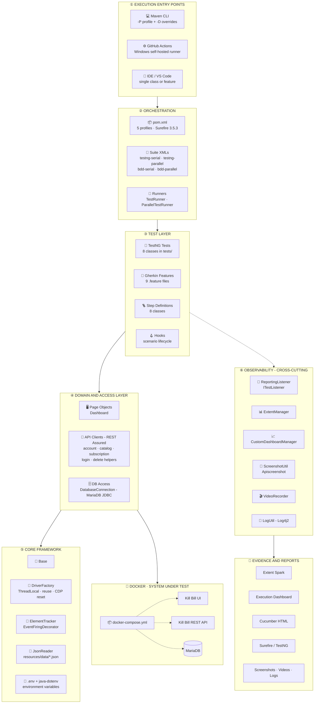
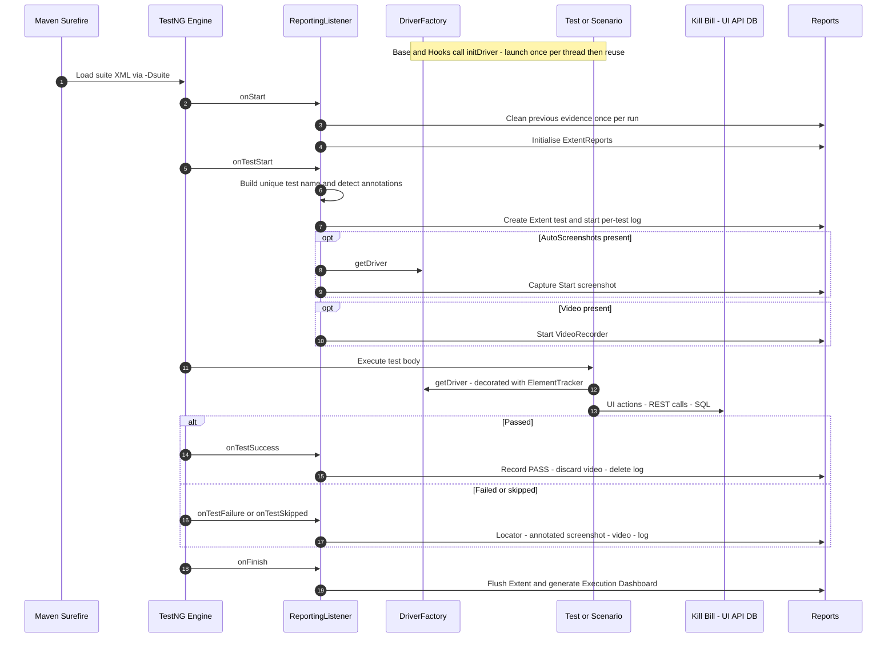
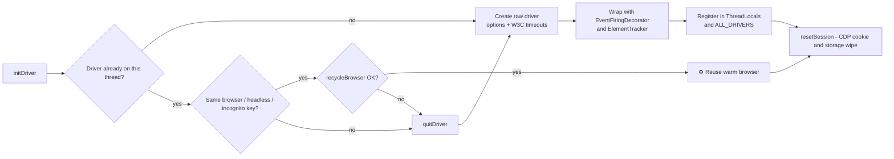
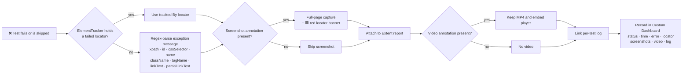
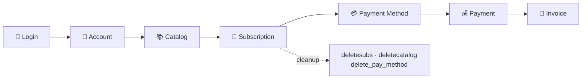
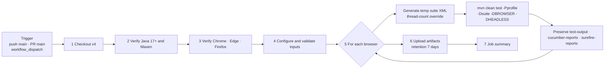

<div align="center">


<br/>


### A production-grade, dual-engine **UI + API + DB** test automation framework for the **Kill Bill** subscription billing and payments platform

**[Overview](#overview)** · **[Architecture](#architecture)** · **[Tech Stack](#technology-stack)** · **[Components](#core-components)** · **[Reports](#reporting-and-evidence)** · **[Execution](#execution-matrix)** · **[CI/CD](#cicd-pipeline)** · **[Getting Started](#getting-started)** · **[License](#license)**

</div>

---

## Overview

**KillBill Fintech Automation Framework** validates the complete billing lifecycle of [Kill Bill](https://killbill.io) (an open-source subscription billing and payments platform): **authentication → accounts → catalog → subscriptions → payment methods → payments → invoices**.

It is built around **two interchangeable test engines**, **TestNG** and **Cucumber BDD (Gherkin)**, that share one hardened core: a thread-safe `DriverFactory`, REST Assured API clients, a MariaDB access layer, JSON-driven test data, and a self-built observability stack that produces **four independent report types** plus per-test screenshots, videos and logs. The system under test runs in **Docker**, so the whole environment can be reproduced on any machine with a single command.

> **What makes it different:** failures are not just reported, they are *explained*. The framework tracks the exact element and locator that failed, **paints an invalid locator onto the screenshot with a red banner**, attaches video and a per-test log, and feeds everything into a **custom-built execution dashboard**.

### At a glance

| Metric | Value |
|---|---|
| Language / build | Java 17 · Maven (Surefire 3.5.3, Compiler 3.14.1) |
| Test engines | **2**: TestNG 7.12.0 and Cucumber 8.0.4 (`cucumber-testng`) |
| Execution modes | Serial and Parallel, for both engines (**4 suite XMLs**) |
| Maven profiles | **5**: `testng-serial` (default) · `testng-parallel` · `bdd-serial` · `bdd-parallel` · `single-test` |
| Browsers | **3**: Chrome, Edge, Firefox (headless / incognito / in-private supported) |
| Gherkin feature files | **9** |
| TestNG test classes | **8** |
| Step-definition classes | **8** |
| API client classes | **8** (create + cleanup) |
| JSON data sets | **8** |
| Report types | **4**: Extent Spark · Custom Execution Dashboard · Cucumber HTML · TestNG/Surefire |
| Custom annotations | **3**: `@Screenshot` · `@AutoScreenshots` · `@Video` |
| Environment | **Docker / Docker Compose**: containerised system under test (`docker-compose.yml`) |
| CI | GitHub Actions on a self-hosted **Windows x64** runner, multi-browser matrix loop |

---

## Highlights

| | Capability | Details |
|---|---|---|
| 🧬 | **Dual engine** | Run the same core through **TestNG** classes *or* **Cucumber** features, each with serial and parallel suites. |
| 🚗 | **Centralised `DriverFactory`** | One place for browser, headless and incognito config. Precedence: `-D` property → environment variable → factory default. |
| ♻️ | **Warm browser reuse** | Launch once per thread, then recycle: dismiss alerts, close extra tabs, reset to tab 1, wipe cookies and storage via **CDP** (no page load). |
| ⚡ | **Speed-tuned launch** | Timeouts sent as **W3C capabilities**, `PageLoadStrategy.EAGER`, window size via launch args, trimmed Chromium/Firefox background work. |
| 🧵 | **Thread-safe by design** | `ThreadLocal` drivers, per-thread test context, concurrent driver registry, parallel `quitAllDrivers()` plus JVM shutdown hook. |
| 🎯 | **Failed-locator intelligence** | `ElementTracker` (Selenium `EventFiringDecorator`) captures the last element and failed `By`; regex fallback parses locators from exception text. |
| 🟥 | **Invalid-locator red banner** | Full-page screenshot annotated with a red banner naming the broken locator. |
| 📸 | **API "on the go" screenshots** | Numbered, ordered evidence screenshots for API tests (`@AutoScreenshots`). |
| 📈 | **Custom dashboard** | Hand-built `ExecutionDashboard.html` with status, timing, locator, error, screenshots, video and log per test. |
| 🥒 | **Gherkin report** | Native Cucumber HTML report at `target/cucumber-reports/cucumber.html`. |
| 🎬 | **Video on demand** | `@Video` records MP4 through JavaCV and FFmpeg. Kept only for failed or skipped tests. |
| 🧹 | **Self-cleaning evidence** | Stale evidence wiped once per run. Logs of **passed** tests are auto-deleted. |
| 🗄️ | **DB layer** | MariaDB JDBC access for data verification and setup. |
| 🐳 | **Dockerised environment** | One command (`docker compose up -d`) brings up the system under test, so every machine runs against the same environment. |
| 🔐 | **Secrets-safe config** | `.env` locally (java-dotenv), GitHub Actions `vars` and `secrets` in CI. |
| 🚦 | **CI-ready** | Parameterised `workflow_dispatch`, input validation, multi-browser loop, per-browser artifacts, job summary. |

---

## Architecture

The framework is a six-layer stack: **entry points → orchestration → tests → domain access → core → observability**, with a cross-cutting listener that turns every test run into evidence.



### Layer responsibilities

| # | Layer | Responsibility | Key files |
|---|---|---|---|
| ① | **Entry points** | Trigger runs from Maven, CI or IDE. | `pom.xml`, `.github/workflows/maven.yml` |
| ② | **Orchestration** | Choose engine, mode, threads and suite. | `testng-*.xml`, `bdd-*.xml`, `runners/TestRunner`, `runners/ParallelTestRunner` |
| ③ | **Test layer** | Express *what* is validated, as TestNG classes or Gherkin scenarios. | `tests/*`, `features/*.feature`, `stepdefinitions/*`, `hooks/Hooks` |
| ④ | **Domain / access** | Talk to the product: UI page objects, REST clients, SQL. | `pages/Dashboard`, `API/*`, `DB/DatabaseConnection` |
| ⑤ | **Core** | Browser lifecycle, element tracking, test data, configuration. | `base/Base`, `base/DriverFactory`, `ElementTracker`, `JsonReader`, `.env` |
| ⑥ | **Observability** | Turn every execution into reports, screenshots, video and logs. | `utils/artifact/ReportingListener`, `utils/report/*`, `utils/screenshot/*`, `utils/Videocapture/*`, `utils/log/LogUtil` |
| 🐳 | **Environment (Docker)** | Containerised system under test that the API, UI and DB layers run against. | `docker-compose.yml` |

### Test lifecycle



### Browser lifecycle (`DriverFactory.initDriver`)



### Failure-evidence pipeline



### Business flow under test



---

## Technology Stack

| Area | Technology | Version |
|---|---|---|
| Language | Java (`maven.compiler.release`) | **17** |
| Build | Maven · Compiler Plugin · Surefire Plugin | 3.14.1 · 3.5.3 |
| UI automation | Selenium Java | **4.26.0** |
| Driver management | WebDriverManager (bonigarcia) | 6.3.3 |
| Test engine 1 | TestNG | **7.12.0** |
| Test engine 2 | Cucumber Java + Cucumber TestNG | **8.0.4** |
| API automation | REST Assured + json-path + xml-path | 6.0.1 |
| Database | MariaDB Java Client | 3.5.3 |
| Config | java-dotenv | 5.2.2 |
| JSON | Jackson Databind (+ jdk8 datatype, test scope) | 2.18.1 |
| Reporting | ExtentReports (Spark) | 5.1.2 |
| Logging | Log4j2 API/Core/SLF4J2 binding · SLF4J API | 2.24.1 · 2.0.17 |
| Screenshots | Selenium Shutterbug (full-page) | 1.6 |
| Video | JavaCV + `ffmpeg-platform` | 1.5.14 · 8.1.2-1.5.14 |
| Browsers | Chrome · Edge · Firefox | latest installed |
| Containers | Docker · Docker Compose | `docker-compose.yml` |
| CI | GitHub Actions (self-hosted Windows x64) | `checkout@v4`, `upload-artifact@v4` |

---

## Project Structure

```text
Selenium_java_Kill_bill
├── pom.xml                         # Dependencies, 5 profiles, Surefire config
├── testng-serial.xml               # TestNG serial suite   (default)
├── testng-parallel.xml             # TestNG parallel suite
├── bdd-serial.xml                  # Cucumber serial suite
├── bdd-parallel.xml                # Cucumber parallel suite
├── .github/
│   └── workflows/maven.yml         # "Windows Selenium CI" workflow
├── src/main
│   ├── java
│   │   ├── API/                    # REST Assured clients
│   │   │   ├── Login · account · create_accountApi · catalog · subscription
│   │   │   └── deletecatalog · deletesubs · delete_pay_method      (cleanup)
│   │   ├── base/
│   │   │   ├── Base.java
│   │   │   └── DriverFactory.java  # Thread-safe browser lifecycle
│   │   ├── DB/DatabaseConnection.java
│   │   └── utils/
│   │       ├── artifact/ReportingListener.java     # ITestListener, the evidence engine
│   │       ├── data_driven/JsonReader.java
│   │       ├── log/LogUtil.java
│   │       ├── report/{ExtentManager, CustomDashboardManager}.java
│   │       ├── screenshot/{Screenshot, AutoScreenshots, Apiscreenshot,
│   │       │               ScreenshotUtil, ElementTracker}.java
│   │       └── Videocapture/{Video, VideoRecorder}.java
│   └── resources
│       ├── log4j2.xml
│       └── data/                   # account · catalog · invoice · Login · payment
│                                   # pay_method · subscription · testData  (.json)
├── src/test
│   ├── java
│   │   ├── hooks/Hooks.java
│   │   ├── pages/Dashboard.java
│   │   ├── runners/{TestRunner, ParallelTestRunner}.java
│   │   ├── stepdefinitions/        # CreateAccount · CreateCatalog · CreateInvoice
│   │   │                           # CreatePayment · Createpaymentmethod · CreateSubs
│   │   │                           # LoginSteps · LoginTest
│   │   └── tests/                  # Create_Account · Create_Catalog · Create_Invoice
│   │                               # Create_Payment · Create_pay_method · Create_Subs
│   │                               # Login_Test · Login_validation
│   └── resources/features/         # CreateAccount · CreateCatalog · CreateInvoice
│                                   # CreatePayment · CreatePaymethod · CreateSubs
│                                   # KillBillExecution · Login · Login_Test (.feature)
├── target/                         # (generated) classes, surefire-reports, cucumber-reports
└── test-output/                    # (generated) dashboard, extent-report, logs, screenshots, video
```

---

## Core Components

### 1. `DriverFactory`: the browser engine room

| Feature | Behaviour |
|---|---|
| **Centralised config** | `DEFAULT_BROWSER = chrome`, `DEFAULT_HEADLESS = false`, `DEFAULT_INCOGNITO = false`, overridable at runtime. |
| **Override precedence** | `-DBROWSER` / `-Dbrowser` → env `BROWSER` / `browser` → factory default. Same for `HEADLESS` and `INCOGNITO`. |
| **Supported browsers** | `chrome`, `edge`, `firefox`. Anything else throws a clear `IllegalArgumentException`. |
| **Backward-compatible overloads** | `initDriver(boolean)` and `initDriver(String, boolean, boolean)` delegate to the centralised config. `initCustomDriver(...)` is the explicit per-test override. |
| **Thread safety** | `ThreadLocal` for `DRIVER` (decorated), `RAW_DRIVER` and `CONFIG_KEY`, plus a concurrent `ALL_DRIVERS` set. |
| **Launch once, reuse** | Config key `browser|headless|incognito`. Same key and healthy session → reuse. Different key or dead session → quit and rebuild. |
| **`recycleBrowser`** | Dismisses stray alerts, closes extra tabs, switches to tab 1 (which also exits iframes), and doubles as a health check. |
| **`resetSession(baseUrl)`** | Chromium: CDP `Network.clearBrowserCookies` + `Storage.clearDataForOrigin` (no page load, HTTP cache kept). Firefox/other: load base URL → delete cookies → clear `localStorage` and `sessionStorage`. |
| **W3C timeouts at creation** | `implicit=0`, `pageLoad=30s`, `script=15s`, sent as capabilities, saving several HTTP round-trips per launch. **Implicit wait is always zero**: use explicit waits. |
| **Page-load strategy** | `EAGER` on all browsers. |
| **Window handling** | Headless: `--window-size=1920,1080`. Headed: `--start-maximized`. macOS and Firefox: `maximize()`. |
| **Chromium tuning** | `--no-sandbox`, `--disable-dev-shm-usage`, no extensions/notifications/infobars, background-throttling off, component-update/domain-reliability/breakpad off, `--mute-audio`, `--log-level=3`, single consolidated `--disable-features`, `--remote-allow-origins=*`. |
| **Chromium prefs** | Password manager and credential service off, notifications blocked, safe-browsing off, `enable-automation` and `enable-logging` switches excluded. |
| **Edge** | Same tuning as Chrome. Incognito maps to `--inprivate`. |
| **Firefox** | Headless/private args, updates/telemetry/prefetch/notifications/first-run disabled via preferences. |
| **Opt-in image blocking** | `-DBLOCK_IMAGES=true` for faster pages (breaks visual checks and screenshots). |
| **Tracking** | Decorated driver via `EventFiringDecorator(new ElementTracker())`. `getRawDriver()` exposes the unwrapped driver for CDP and screenshots. |
| **Cleanup** | `quitDriver()` (this thread), `quitAllDrivers()` (all threads, parallel stream) and a JVM **shutdown hook** guarantee no orphan browser processes. |

### 2. `ReportingListener`: the evidence engine

A single TestNG `ITestListener` that orchestrates **everything** observable.

| Event | Action |
|---|---|
| `onStart` | Wipes previous evidence **once per run** (`AtomicBoolean`) and initialises `ExtentManager`. |
| `onTestStart` | Builds a unique test name, resets per-test screenshots, detects annotations, starts per-test logging, creates the Extent test, optionally captures a `_Start` screenshot, optionally starts video. |
| `onTestSuccess` | Optional `_Passed` screenshot, Extent PASS, dashboard record, **video discarded**, **log file deleted**, thread-locals cleared. |
| `onTestFailure` / `onTestSkipped` | Logs the throwable, resolves the failed locator, captures an annotated screenshot, captures an API-error screenshot, **keeps the video** and embeds an HTML5 player, links the per-test log, records everything to the dashboard. |
| `onFinish` | Flushes Extent and generates the Custom Execution Dashboard. |

**Unique test naming** (stable across parallel and data-driven runs): `ClassName_methodName` → plus `_<testCaseId>` when the first parameter is a `Map` containing `testCaseId` → otherwise `_TC<n>` for parameterised runs → or `_Run<n>` for repeated invocations. Names are sanitised for filenames.

**Failed-locator resolution:** `ElementTracker.getFailedLocator()` first. If empty, a regex over the exception chain extracts `By.xpath | id | cssSelector | name | className | tagName | linkText | partialLinkText` from the message.

### 3. Custom annotations

Place on a **method or a class**. The listener checks both.

| Annotation | Package | Effect |
|---|---|---|
| `@Screenshot` | `utils.screenshot` | On failure/skip: full-page screenshot with the failing element highlighted and a **red banner showing the invalid locator and error**. |
| `@AutoScreenshots` | `utils.screenshot` | Step-by-step, numbered evidence screenshots (`Start` → steps → `Passed` or `ERROR_*`). Ideal for **API tests**. |
| `@Video` | `utils.Videocapture` | Records the test to MP4 (`JavaCV` + FFmpeg). Kept only if the test fails or is skipped. |

```java
@Test
@Screenshot
@AutoScreenshots
@Video
public void createAccountApiTest() {
    // test body
}
```

### 4. Supporting utilities

| Component | Role |
|---|---|
| `ElementTracker` | Selenium listener that records the **last interacted element** and the **last failed locator**. Cleared after each test. |
| `ScreenshotUtil` | Full-page capture (Shutterbug) with element highlight and the red locator banner. |
| `Apiscreenshot` | Numbered per-test screenshot manager for API tests. Exposes the last path and the full CSV list for the dashboard. |
| `ExtentManager` | Singleton ExtentReports (Spark) at `test-output/extent-report/ExtentReport.html`. |
| `CustomDashboardManager` | Thread-safe test-record store (`TestRecord`) and HTML dashboard generator. |
| `VideoRecorder` | Start/stop MP4 recording with keep-or-discard semantics. |
| `LogUtil` | Per-test log files plus a master `automation_suite.log` (Log4j2). Passed-test logs are deleted automatically. |
| `JsonReader` | Data-driven loader for `src/main/resources/data/*.json`. |
| `DatabaseConnection` | MariaDB JDBC access. |
| `Hooks` | Cucumber scenario lifecycle (driver setup, teardown, session reset). |

---

## Reporting and Evidence

Four reports, one run. Click any thumbnail to open the original.

### 1 · Custom Execution Dashboard (built from scratch)

**Location:** `test-output/dashboard/ExecutionDashboard.html`

A hand-built dashboard generated by `CustomDashboardManager` at suite end. Every test carries: **name, class, method, status (PASS / FAIL / SKIP), duration, start time, exception, failed locator, screenshots, video and a link to its detailed log.**

<table>
  <tr>
    <td width="50%"><a href="https://drive.google.com/file/d/1bQ-pYgzgrUgeEMWtsjeK9Uxk72YAbym5/view?usp=sharing"></a><br/><sub><b>Dashboard · overview</b></sub></td>
    <td width="50%"><a href="https://drive.google.com/file/d/1DaCblVJ1rK_5xhmO4yzQkNIQntZG2MZv/view?usp=sharing"></a><br/><sub><b>Dashboard · test details</b></sub></td>
  </tr>
</table>

### 2 · Failed-test invalid-locator annotation

When a test fails on a bad locator, the framework captures a **full-page screenshot**, highlights the context and stamps the **invalid locator on a red banner at the top of the image**, so the root cause is visible without opening a log.

[](https://drive.google.com/file/d/1WaCayd38RPnPbBGZsjqnzc-l53mzuV0B/view?usp=sharing)

**How it works:** `ElementTracker` records the failing `By` → `ReportingListener` falls back to regex extraction from the exception → `ScreenshotUtil.captureFullPage(driver, name, lastElement, failedLocator, errorMessage)` renders the banner → the image is attached to Extent and the dashboard.

### 3 · API test screenshots "on the go"

API tests have no natural UI, so `@AutoScreenshots` records **numbered, ordered evidence** (`01_…_Start.png` → `02_Initial_Page.png` → … → `05_…_Passed.png`) under `test-output/extent-report/apiscreenshoot/<TestClass>/`. A failing run adds an `_ERROR_FAILED` shot, and the whole sequence is attached to the dashboard.

[](https://drive.google.com/file/d/1oHuZWgfe_WZpSmIKUsFhk8YQdfpasOE5/view?usp=sharing)

### 4 · Cucumber BDD Gherkin report

**Location:** `target/cucumber-reports/cucumber.html`. Feature → scenario → step breakdown with pass/fail per step.

[](https://drive.google.com/file/d/1czEER3KMyGTxMSyW_Bd2FsT3ixUnzCsh/view?usp=sharing)

### Report matrix

| Report | Path | Produced by |
|---|---|---|
| Custom Execution Dashboard | `test-output/dashboard/ExecutionDashboard.html` | `CustomDashboardManager` |
| Extent Spark report | `test-output/extent-report/ExtentReport.html` | `ExtentManager` + `ReportingListener` |
| Cucumber Gherkin report | `target/cucumber-reports/cucumber.html` | Cucumber plugin |
| TestNG / Surefire | `target/surefire-reports/` (`index.html`, `emailable-report.html`, `testng-results.xml`, JUnit XML, `testng-failed.xml`) | Surefire + TestNG |
| Master log | `test-output/logs/automation_suite.log` | Log4j2 / `LogUtil` |

---

## Test Coverage

| Domain | Gherkin feature | TestNG class | Step definitions | API client |
|---|---|---|---|---|
| Authentication | `Login.feature`, `Login_Test.feature` | `Login_Test`, `Login_validation` | `LoginSteps`, `LoginTest` | `Login` |
| Account | `CreateAccount.feature` | `Create_Account` | `CreateAccount` | `account`, `create_accountApi` |
| Catalog | `CreateCatalog.feature` | `Create_Catalog` | `CreateCatalog` | `catalog`, `deletecatalog` |
| Subscription | `CreateSubs.feature` | `Create_Subs` | `CreateSubs` | `subscription`, `deletesubs` |
| Payment method | `CreatePaymethod.feature` | `Create_pay_method` | `Createpaymentmethod` | `delete_pay_method` |
| Payment | `CreatePayment.feature` | `Create_Payment` | `CreatePayment` | n/a |
| Invoice | `CreateInvoice.feature` | `Create_Invoice` | `CreateInvoice` | n/a |
| End-to-end | `KillBillExecution.feature` | n/a | n/a | n/a |

**Data-driven:** every domain has a JSON data set in `src/main/resources/data/` (`account`, `catalog`, `invoice`, `Login`, `payment`, `pay_method`, `subscription`, `testData`), loaded through `JsonReader`. Data-provider rows may carry a `testCaseId` that is propagated into report, screenshot and log file names.

---

## Execution Matrix

### Maven profiles

| Profile | Suite | `thread.count` | `dataprovider.thread.count` | Activation |
|---|---|:---:|:---:|---|
| `testng-serial` | `testng-serial.xml` | 1 | 1 | **Default** |
| `testng-parallel` | `testng-parallel.xml` | 4 | 2 | `-Ptestng-parallel` |
| `bdd-serial` | `bdd-serial.xml` | 1 | 1 | `-Pbdd-serial` |
| `bdd-parallel` | `bdd-parallel.xml` | 1 | 2 | `-Pbdd-parallel` |
| `single-test` | none (suite override cleared) | n/a | n/a | Auto-activates when `-Dtest=<Class>` is set |

Surefire runs with `forkCount=1`, `reuseForks=true`, `failIfNoTests=true`, and forwards `BROWSER`, `HEADLESS`, `INCOGNITO`, `REUSE_BROWSER`, `thread.count` and `dataprovider.thread.count` to the forked JVM.

### Commands

```bash
# TestNG: serial (default), parallel, or one class
mvn clean test
mvn clean test -Ptestng-parallel
mvn test -Dtest=Create_Account

# Cucumber BDD: serial, parallel, or one feature
mvn clean test -Pbdd-serial
mvn clean test -Pbdd-parallel
mvn clean test -Pbdd-serial -Dcucumber.features=src/test/resources/features/Login_Test.feature

# Browser / mode overrides (any profile)
mvn clean test -Pbdd-parallel -DBROWSER=firefox -DHEADLESS=true -DINCOGNITO=true

# Custom parallelism
mvn clean test -Ptestng-parallel -Dthread.count=6 -Ddataprovider.thread.count=3

# Faster pages (disables images, so screenshots will be incomplete)
mvn clean test -DBLOCK_IMAGES=true
```

### Runtime switches

| Switch | Values | Default | Notes |
|---|---|---|---|
| `BROWSER` | `chrome` · `edge` · `firefox` | `chrome` | `-D` or env var, upper or lower case |
| `HEADLESS` | `true` · `false` | `false` | Chromium uses `--headless=new` |
| `INCOGNITO` | `true` · `false` | `false` | Edge uses `--inprivate`, Firefox `-private` |
| `REUSE_BROWSER` | `true` · `false` | `true` | Forwarded by Surefire to the forked JVM |
| `BLOCK_IMAGES` | `true` · `false` | `false` | Opt-in speed boost |
| `suite` | suite XML path | profile-driven | Set automatically per profile |

---

## Configuration

Local settings live in `src/main/java/env/.env` (loaded with **java-dotenv**). CI supplies the same values as environment variables. **Never commit real credentials.**

```properties
# Example keys. Match the names used in your .env
BASE_URL=http://localhost:8080
API_BASE_URL=http://localhost:8080
DB_URL=jdbc:mariadb://localhost:3306/killbill
DB_USERNAME=<db-user>
DB_PASSWORD=<db-password>
LOGIN_USERNAME=<ui-user>
LOGIN_PASSWORD=<ui-password>
```

---

## Parallel Execution Design

| Concern | Strategy |
|---|---|
| Driver isolation | One browser per thread via `ThreadLocal<WebDriver>`. No shared sessions. |
| Test context | `ReportingListener` keeps `ExtentTest`, `VideoRecorder`, test id, script name and the auto-screenshot flag in `ThreadLocal`s, cleared on every exit path. |
| Unique artifacts | Test-name builder uses `ConcurrentHashMap<String, AtomicInteger>` counters, so parallel data-driven runs never collide on filenames. |
| One-time setup | Evidence cleanup guarded by `AtomicBoolean.compareAndSet`. |
| Shutdown | `quitAllDrivers()` closes every thread's browser **in parallel**, plus a JVM shutdown hook as a safety net. |
| Speed | Warm-browser reuse with CDP cookie/storage reset, W3C-capability timeouts, `EAGER` loading, background-throttling disabled for parallel *headed* runs. |
| Waiting | Implicit wait fixed at **0**, explicit waits only (no hidden latency, no flaky mixes). |

---

## CI/CD Pipeline

Workflow **"Windows Selenium CI"** (`.github/workflows/maven.yml`) runs on a **self-hosted Windows x64 runner** (PowerShell, 120-minute timeout).



### Manual dispatch inputs

| Input | Options / default |
|---|---|
| `framework` | `bdd` (default) · `testng` |
| `execution` | `serial` (default) · `parallel` |
| `browser` | `chrome` (default) · `edge` · `firefox` · `all` |
| `headless` | `"true"` (default) · `"false"` |
| `class_name` | TestNG class without `.java` (optional) |
| `feature_file` | default `src/test/resources/features/Login_Test.feature` |
| `thread_count` | default `4` (forced to `1` in serial mode) |

### Pipeline details

- **Triggers:** `workflow_dispatch`, `push` to `main`, `pull_request` to `main`. Push/PR defaults: BDD · serial · Chrome · headless.
- **Environment:** `API_BASE_URL`, `BASE_URL`, `DB_URL`, `DB_USERNAME`, `LOGIN_USERNAME` from repository **variables**. `DB_PASSWORD`, `LOGIN_PASSWORD` from **secrets**.
- **Target environment:** the workflow reaches the system under test through `BASE_URL`, `API_BASE_URL` and `DB_URL`, so the Dockerised stack (or an equivalent environment) must be reachable from the runner.
- **Fail-fast validation:** rejects invalid framework, mode, browser or headless values, non-positive thread counts, malformed TestNG class names, missing feature files or missing suite XML.
- **Profile resolution:** `<framework>-<execution>` maps to the right Maven profile and suite XML.
- **Parallel tuning:** a **temporary suite XML** is generated per browser with `thread-count` (TestNG) or `data-provider-thread-count` (BDD) overridden.
- **Multi-browser `all`:** runs Chrome, Edge and Firefox sequentially and **keeps going on failure**, then fails the job at the end listing every failed browser.
- **Per-browser artifacts:** `ci-artifacts/<browser>/` holds `maven-output.log`, `execution.log`, `config/` (temp suite XML), `test-output/`, `cucumber-reports/`, `surefire-reports/`.
- **Upload:** `selenium-ci-reports-<run_number>` (`if: always()`, 7-day retention).
- **Summary:** a Markdown table of framework, mode, profile, browsers, headless, threads, class and feature is published to the job summary.

---

## Getting Started

**Prerequisites:** JDK **17+** · Maven **3.9+** · Chrome / Edge / Firefox · **Docker** with Compose v2 (Docker Desktop on Windows / macOS) to run the environment from `docker-compose.yml` · a configured `.env`.

```bash
# 1. Clone
git clone https://github.com/raxitsharma/Selenium_java_Kill_bill.git
cd Selenium_java_Kill_bill

# 2. Start the system under test
docker compose up -d

# 3. Configure credentials and URLs
#    edit src/main/java/env/.env

# 4. Run
mvn clean test                       # TestNG serial
mvn clean test -Pbdd-parallel        # Cucumber parallel
```

**Docker environment cheat-sheet**

| Task | Command |
|---|---|
| Start the stack in the background | `docker compose up -d` |
| Check container status / health | `docker compose ps` |
| Follow logs | `docker compose logs -f` |
| Stop (keep data) | `docker compose down` |
| Full reset (also removes volumes) | `docker compose down -v` |

**Open the results**

```text
test-output/dashboard/ExecutionDashboard.html      ← custom dashboard
test-output/extent-report/ExtentReport.html        ← Extent Spark
target/cucumber-reports/cucumber.html              ← Gherkin report
target/surefire-reports/index.html                 ← TestNG
```

---

## Evidence Output Layout

```text
test-output/
├── dashboard/ExecutionDashboard.html
├── extent-report/
│   ├── ExtentReport.html
│   ├── apiscreenshoot/<TestClass>/01_…_Start.png … NN_…_Passed.png
│   └── spark/                      # report assets (css, js, fonts)
├── screenshots/<Test>_FAILED.png   # annotated failure screenshots
├── video/<Test>.mp4                # failed / skipped tests only
└── logs/
    ├── automation_suite.log        # master log
    └── <Test>.log                  # per-test log (deleted when the test passes)
```

---

## Engineering Principles

1. **Zero implicit waits.** Explicit waits only, with deterministic behaviour.
2. **Configuration over code.** Browser, mode and threads change through `-D` flags, env vars and Maven profiles, never by editing tests.
3. **Evidence by default.** Every failure ships with locator, screenshot, video and log.
4. **Thread-safety first.** No shared mutable state across threads.
5. **Fast feedback.** Warm browsers, capability-level timeouts, trimmed browser work.
6. **Clean runs.** Stale artifacts are purged, passed-test noise is deleted, orphan browsers are impossible.
7. **One core, two engines.** TestNG and Cucumber reuse the same drivers, clients, data and reporting.
8. **CI parity.** The pipeline uses the same Maven profiles and flags as a local run.
9. **Reproducible environments.** Docker Compose gives every machine the same system under test.

---

## Troubleshooting

| Symptom | Fix |
|---|---|
| `WebDriver is not initialized for thread [...]` | `DriverFactory.initDriver()` was not called on that thread. Check `Base` / `Hooks`. |
| Screenshots look incomplete | You ran with `-DBLOCK_IMAGES=true`. Remove it. |
| `-Dtest=...` ignores the suite XML | Intentional: the `single-test` profile clears `suiteXmlFiles`. |
| Stale state between tests | Call `DriverFactory.resetSession(baseUrl)` after a reused `initDriver()`. |
| Wrong browser launched | Check precedence: `-D` property → env var → default (`chrome`). |
| CI fails in "Verify" step | Java below 17 or Maven missing on the runner `PATH`. |
| Passed test has no log | By design. Logs are retained only for failures and skips. |
| Connection refused on API / UI / DB | Containers not up or not healthy yet. Run `docker compose ps` and `docker compose logs -f`. |
| Port already in use on `docker compose up` | Stop the conflicting process or container, then run `docker compose up -d` again. |
| Stale or inconsistent data between runs | Reset with `docker compose down -v`, then `docker compose up -d` to start from a clean environment. |

---

## License

**Proprietary Software License · Copyright © 2026 Raxit Sharma. All Rights Reserved.**

This repository (source code, test scripts, configuration, test data and documentation) is confidential and proprietary. Without the Owner's prior written permission you may **not** copy, distribute, modify, reverse engineer, sell, sublicense, disclose, or otherwise use any part of it. Unauthorised use terminates any rights that may have been granted. See the full terms in [`LICENSE`](LICENSE).

For licensing inquiries, permissions or authorised-use requests: **raxit.sharma.qa@gmail.com**

---

<div align="center">

### Author

**Built and maintained by Raxit Sharma**
*QA Automation Engineer · Selenium · TestNG · Cucumber · REST Assured · CI/CD*

[](https://github.com/raxitsharma)
[](mailto:raxit.sharma.qa@gmail.com)

© 2026 Raxit Sharma · All Rights Reserved

⭐ **If this framework helped you, star the repo!** ⭐


</div>
